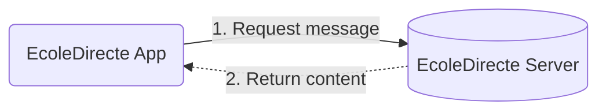
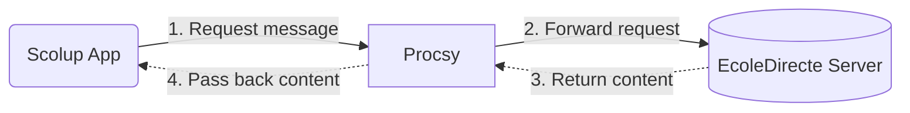

  <picture><source media="(prefers-color-scheme: dark)" srcset="https://shieldcn.dev/header/grid.svg?title=Security&amp;subtitle=How+to+report+vulnerabilities+%26+why+Scolup+is+safe&amp;logo=lu%3AShield&amp;mode=dark&amp;theme=zinc" /></picture>

## ⚠️ Reporting a vulnerability

If you discover a security vulnerability in Scolup, **please do not open a public issue or PR.**

Instead, email us at **[security@scolup.com](mailto:security@scolup.com)** with:

- A description of the vulnerability
- Steps to reproduce it
- The potential impact

We will acknowledge your report within **48 hours** and aim to provide a fix or mitigation plan as soon as possible. We will credit reporters who wish to be named, unless you prefer to remain anonymous.

### 💪 Supported versions

Security patches are applied to the **latest release** only.

### 🌐 Scope

If you find vulnerabilities in other projects from us that are used by Scolup, like Linkdirecte or Procsy, please go to their respective repo and follow their own security policy.

## 👾 Why Scolup is safe

We consider Scolup **almost as safe as EcoleDirecte itself**. Why almost ? Well…

Reading a message on EcoleDirecte directly looks like this:

Doing the same thing on Scolup adds one hop:

### Why the extra step exists

Browsers enforce CORS: if a page on domain B calls a server that only accepts domain A, the browser blocks the request before it ever reaches the network. EcoleDirecte's servers only accept requests from `ecoledirecte.com`, so Scolup can't call them directly from a browser.

There are two ways around that:

- **A browser extension**, more secure, but paid, harder to maintain, and unavailable on some platforms.
- **A proxy**, simpler to build, simpler to maintain, works everywhere out of the box.

We went with the proxy. There's a second reason too: a long-standing Chromium bug blocks apps from setting a custom user agent, and EcoleDirecte's server requires one specific value. A proxy makes fixing easy.

That's why we built [**Procsy**](https://github.com/Scolup/Procsy), a small proxy running on Cloudflare Workers. Its full source is public under AGPL-3.0.

### What Procsy actually does with your requests

This is the part that matters most, so here it is directly:

- Procsy holds no database, no KV namespace, and no session storage. Each request is handled independently and nothing persists after it's served.
- Procsy does not log request or response content.
- TLS does end at the Worker (once from your device, once again to EcoleDirecte), so Procsy briefly handles your request unencrypted, in memory, inside an isolated Cloudflare execution sandbox, the same way any HTTPS-terminating proxy or CDN works. Nothing is written to disk.

Because the code is open source, you don't have to take our word for any of this, you can read it.
